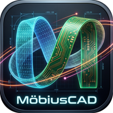

# MöbiusCAD



MöbiusCAD (formerly STEP Viewer) is a STEP and Gerber viewer for mechanical engineers, technicians and inspectors that runs entirely in the browser. OpenCASCADE parses the file in a Web Worker (WebAssembly), so **the model never leaves your computer**.

**Live:** [aerocat.tech/tools/mobiuscad](https://aerocat.tech/tools/mobiuscad/) · [GitHub Pages](https://kothf.github.io/step-viewer/)

## Features

- **Formats**: STEP AP203 / AP214 / AP242 (`.step`, `.stp`), IGES, BREP. Assembly tree, part names and colours are kept.
- **Topology-aware**: faces and edges are rebuilt from the B-rep tessellation and classified (plane, cylinder, sphere; line, circle, arc). Radii, centres, axes and lengths come from the analytic fit, not from triangles.
- **Display**: shaded + edges, shaded, wireframe, hidden line, X-ray; perspective / orthographic; NavCube (26 views) and view presets; ambient occlusion; light and dark themes.
- **Smart measure** (default): click one entity for its size, a second for what relates them: pitch between holes, distance between parallel faces, centre to face, angle, or shortest distance. Details appear in a corner card; Pin keeps the result.
- **Measure tools** with snapping to vertices, midpoints, circle centres, face centres, edges and faces:
  - point to point (with ΔX/ΔY/ΔZ), shortest distance between any two points, edges or faces
  - radius, diameter, centre to centre, hole pitch (axis to axis), edge and arc length (with sweep)
  - angle between edges/faces/axes, 3-point angle
  - point coordinates and surface normal, bounding box
  - colour-coded, pinned per file in the browser, exported as CSV or a PDF inspection report
- **Sections**: up to 3 planes: XY / YZ / XZ, on a face, through 3 points or facing the view. Solid caps (stencil buffer) with ANSI31 hatching or per-part colours; a gizmo to drag and tilt the plane; numeric offset, step, azimuth/elevation; flip.
- **Measuring on the cut**: the cut profile is computed and drawn; snap to its curves, vertices, midpoints and circle centres (exact for cylinders cut square-on), or to the cap face. "Snap to cut only" keeps snapping in the section plane. Cut area per plane.
- **Exploded view** following the assembly hierarchy, plus dragging single parts.
- **Mass properties**: volume, mass (material presets or custom density), surface area, centre of mass, bounding box.
- **Model tree**: show/hide, isolate, colour and opacity per part or sub-assembly; filter by name, `size>50`, `vol<1000`.
- **Metadata**: STEP header, protocol, product revisions, materials, AP242 PMI entity counts.
- **Export**: PNG at 2–4× (optionally transparent, labels included), STL, OBJ, glTF (GLB), PDF report.
- **PCB / Gerber view**: open Gerber RS-274X and X2 layers, Excellon drill files, or a `.zip` of a whole Gerber set (drop several files at once). Layers are recognised from X2 file functions or common names (KiCad, Altium/Protel, Eagle) and all drawn on a dark 2D canvas, with per-layer show/hide, colour and drag-to-reorder stacking; bottom (mirrored) view.
- **English / Russian interface** with an EN / RU switch in the header (remembered; `?lang=ru` in the URL), a Help dialog (`F1`) covering the features, measuring tools and shortcuts in both languages, and first-use tips that can be turned off.
- **3D board**: switch the PCB view to 3D (`3`, back with `2`) to see the board outline extruded to its thickness with cut-outs, drilled and plated holes, copper, solder mask and silkscreen on both sides. It orbits like the model view, and the PCB measuring tools (smart, point to point, clearance, polyline, area, with snapping) work on the face you look at. **Measure as 3D model** opens the board body in the model view for its tools: thickness, hole diameters, angles, sections, mass properties and STL/glTF export.
  - Smart: one click shows a pad's aperture and size, a track's width and length, a hole's diameter and plating, a region's area, plus X2 net, pin and pad function; a second click gives pitch and edge-to-edge clearance.
  - Point to point (with ΔX/ΔY), clearance, polyline length and polygon area; Shift+click a pad, region or closed outline (board edge) for its area.
  - Snapping to corners and track ends, pad and hole centres, track edges and the perpendicular onto a track edge; mm, inch or mil with 0–4 decimals.
  - Measurement list with show/hide and delete, CSV, and PNG or SVG export of the view with the measurements.

## Keyboard

| Key | Action |
| --- | --- |
| Left / right drag, wheel | Orbit / pan / zoom to cursor |
| `F`, `0` | Fit, isometric |
| `1`–`5` | Display modes |
| `P` / `O` | Perspective / orthographic |
| `D` `M` `R` `C` `L` `A` `N` `B` | Distance, min distance, radius, centre–centre, length, angle, point, bounding box |
| `I` / `H` / `U` | Isolate / hide selected / show all |
| `Del` | Delete the selected measurement |
| `Esc` | Cancel the tool, clear the selection |
| `F1` / `?` | Help |

In the PCB view: wheel zooms, drag (or Space+drag, middle drag) pans; `Q` smart, `M` point to point, `C` clearance, `L` polyline, `A` area, `Enter` finishes, `Backspace` removes the last point, `P` pins, `F` fits, `B` flips to the bottom view, `2` / `3` switch between the flat and the 3D board, `Esc` cancels.

You can also open a model by URL: `index.html?url=path/to/model.step` (same origin or CORS-enabled).

## Limits

- Distances between curved freeform faces are measured on the tessellation (choose *Fine mesh* for tighter results). Planes, cylinders, circles and lines are exact.
- AP242 PMI/GD&T and material entities are listed but not drawn.
- Volume and mass assume closed solids; open shells are flagged.
- Gerber: layer mirror/rotate/scale (LM, LR, LS) and block apertures (AB) are not applied, the gaps of thermal macro primitives are not cut, and routed Excellon arcs are drawn straight. The viewer says so when a file uses them.

## Development

```bash
npm install
npm run dev        # http://localhost:5173
npm run package    # dist/step-viewer/ + dist/step-viewer-<version>.tar.gz
npm test           # headless-Chromium smoke test of the packaged build
```

Stack: TypeScript, Vite, Three.js, three-mesh-bvh, occt-import-js (OpenCASCADE 7.x as WebAssembly), jsPDF.

### Releasing

1. Bump `version` in `package.json` and add a section to `CHANGELOG.md`.
2. Get it onto `main`, then press **Actions → Release → Run workflow** (on main): it releases `package.json`'s version (or the one typed in) and tags main itself after the tests pass. Pushing a tag (`git tag v1.4.0 && git push origin v1.4.0`) does the same. Don't create the release by hand in GitHub's Releases page: the workflow makes it.
3. The Release workflow uses CI's result for that commit (or runs the smoke test itself), publishes `step-viewer-<version>.tar.gz` (+ `.sha256`) as a GitHub release and deploys GitHub Pages. aerocat.tech pins the release in its `vendor.json`; a workflow there proposes the upgrade as a pull request.

## License

[MIT](LICENSE) © 2026 Andrey Dumchin.

The `occt/` folder of a build contains [occt-import-js](https://github.com/kovacsv/occt-import-js) and [Open CASCADE Technology](https://dev.opencascade.org/), unmodified, under LGPL-2.1 (with the Open CASCADE exception); their license files ship next to them.
